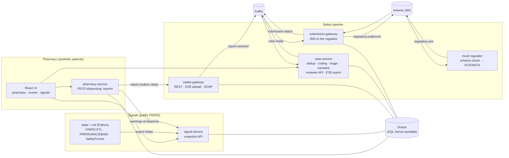

# PharmaVigil

**An AI drug-safety (pharmacovigilance) platform: from the pharmacy counter to the safety signal and back.**

> **Not for clinical or regulatory use.** Spontaneous reports do not prove that a drug caused a reaction.
> The pharmacy side uses synthetic patients only. AI outputs are suggestions; a human reviewer decides.

A pharmacist reports a side effect in one click. The report is de-duplicated, MedDRA-coded and triaged by
models trained for this project, reviewed by a person, exported as a schema-valid ICH E2B(R3) file and
acknowledged by a (mock) regulator over JMS. Drug–event signals computed from public FDA adverse-event reports
(FAERS) come back to the counter as evidence the next time the drug is dispensed.

| | |
|---|---|
| Plan, research and sources | [`docs/PLAN.md`](docs/PLAN.md) |
| Progress, evidence and deviations | [`analysis/PROGRESS.md`](analysis/PROGRESS.md), [`analysis/PROJECT_REPORT.md`](analysis/PROJECT_REPORT.md) |
| Versions and components | [`docs/ARCHITECTURE.md`](docs/ARCHITECTURE.md) |
| Decisions | [`docs/adr/`](docs/adr) (ADR-001 to ADR-010) |
| What only the owner can do | [`OWNER_STEPS.md`](OWNER_STEPS.md) |

## Status in one table

| Part | State | Evidence |
|---|---|---|
| Pharmacy app, reviewer console, signals page | working, tested | 33 Vitest tests; Playwright smoke test against compose (CI) |
| Report → coded, triaged, reviewed case → E2B(R3) → ACK over JMS | working, tested end to end | `services/e2e-tests` (3/3 in CI, official schemas) |
| Kafka pipeline (outbox, idempotent consumers, DLQ, replay-safe) | working, tested | `KafkaPipelineTest`, `EndToEndTest`, ADR-001 |
| SOAP partner intake (WS-Security) and E2B(R3) import/export | working, tested | `SoapIntakeContractTest`, `docs/E2B_R3.md` |
| Oracle primary, SQL Server portable | both test profiles green in CI | ADR-003 |
| Models in Java (ONNX Runtime) | parity proven on a **synthetic fixture bundle** | `ModelParityTest`, ADR-008 |
| Data platform, signal baselines, SafetyFormer, coder, triage, duplicates | code complete, tested on fixtures and synthetic data | `data/tests`, `ml/tests` |
| **Real-data model results** | **pending**: FAERS, VAERS, RxNav and Hugging Face are unreachable from the build environment | owner steps 1, 4–7 |
| Observability, load test | measured on the local stack | `docs/OBSERVABILITY.md`, `docs/PERFORMANCE.md` |
| Helm on Kubernetes (kind), Jenkins | whole stack on kind and the full Jenkins pipeline green in CI (`analysis/m10/jenkins-run.log`) | `docs/KUBERNETES.md`, `docs/JENKINS.md` |
| Azure (AKS, ACR, Key Vault) | Terraform validated and Checkov-clean; **never applied** | `docs/AZURE.md`, owner step 9 |

## The problem

From the sources collected in `docs/PLAN.md` (not re-checked from the build environment, where most of these
sites are blocked):

- Outpatient adverse drug events cause about 4 emergency visits per 1,000 people a year in the US.
- FDA's FAERS database holds about 33 million reports and grows by about 2 million a year; case processing is
  largely manual and takes most of a drug-safety budget.
- Every symptom must be coded to MedDRA by hand or by exact match.
- Classic disproportionality statistics (PRR/ROR) reach AUC 0.64–0.73 on the OMOP reference set.
- Since 1 October 2026 FDA accepts postmarketing safety reports only as ICH E2B(R3) XML.
- Pharmacists see side effects at the counter, but reporting is voluntary and manual.

## Architecture



Five Spring Boot 4.1 services (Java 21), one schema each in Oracle Database Free; every event leaves through a
transactional outbox (ADR-001); Kafka carries the internal pipeline and JMS the regulator hand-over (ADR-002).
The UI is React 19 + TypeScript behind nginx, which routes each `/api/...` path to its service.

## The pipeline, step by step

```mermaid
sequenceDiagram
  autonumber
  actor P as Pharmacist
  participant PH as pharmacy-service
  participant IN as intake-gateway
  participant K as Kafka
  participant CS as case-service
  actor R as Safety reviewer
  participant SG as submission-gateway
  participant MR as Mock regulator (JMS)
  P->>PH: dispense (lots first-expiry-first-out), report a side effect
  PH-->>P: signal evidence for the drug (never a verdict)
  PH->>IN: de-identified report (relay retries while intake is down)
  IN->>K: report.received (outbox, same transaction as the receipt)
  K->>CS: duplicate check (model) → report.deduped
  K->>CS: MedDRA coding suggestions (model) → report.coded
  K->>CS: seriousness triage (model) → case.triaged
  K->>CS: narrative draft (Claude if configured, else template)
  R->>CS: accept or correct codes, seriousness, duplicate; approve narrative and case
  CS->>CS: export E2B(R3), validate against the official schemas
  CS->>K: case.ready (only if schema-valid)
  K->>SG: record message, send on regulatory.outbound
  SG->>MR: E2B(R3) XML
  MR-->>SG: ACK or NACK (with errors)
  SG->>K: submission.status → case ACKNOWLEDGED, or back to review
```

Every stage is idempotent (processed-event table), retried three times, then dead-lettered. Without a model,
cases go to manual coding or "seriousness unknown" and keep moving. Every AI suggestion stores the model name
and version next to the reviewer's final choice.

## Data and models

| | Source | Status |
|---|---|---|
| FAERS (adverse event reports) | FDA quarterly files, 2004Q1 onward; legacy AERS layout handled | ETL tested on fixtures; full run is owner step 4 (Databricks) — [dataset card](docs/DATASET_CARD_FAERS.md) |
| VAERS (vaccine reports with narratives) | HHS VAERS datasets | coder training data; owner step 6 — [dataset card](docs/DATASET_CARD_VAERS.md) |
| Drug names → ingredients | NLM RxNorm (RxNav API) | client with cache and rate limit; tested with a mocked API |
| Reference sets | OHDSI MethodEvaluation (OMOP, EU-ADR) | **real**: OMOP 399 pairs (165+/234−), EU-ADR 93 pairs (43+/50−) — `analysis/m2/refsets.json` |
| Pharmacy patients | Synthea-format synthetic CSV | demo data only |

| Model | What it does | Design |
|---|---|---|
| Baselines | PRR, ROR, IC (shrunk), EBGM/EB05 (MGPS) | `ml/.../signals`, ADR-005 |
| **SafetyFormer** | self-supervised set Transformer trained from scratch on FAERS reports; scores drug–event pairs | ADR-005, ADR-006 (time-travel test), [model card](ml/signals/MODEL_CARD.md) |
| MedDRA coder | biomedical encoder + head, merged with retrieval over PT names | ADR-007, [model card](ml/coder/MODEL_CARD.md) |
| Seriousness triage | LightGBM; never sees outcome fields or outcome-revealing terms | [model card](ml/triage/MODEL_CARD_SERIOUSNESS.md) |
| Duplicate detection | LightGBM on pair features (a proxy: FAERS versions of one case) | [model card](ml/triage/MODEL_CARD_DUPLICATES.md) (states the proxy) |

Training labels come from human coding in FAERS/VAERS and Sumit's hand-labelled set, never from Claude. No
MedDRA dictionary file is in the repository; only PT strings that appear in public FAERS/VAERS files.

## Results (every number carries its scope)

**Engineering** (measured; CI run on GitHub runners unless noted):

| Measure | Result | Scope |
|---|---|---|
| Java tests | 103 tests, 0 failures, 0 skipped (CI, official schemas present); coverage gate ≥ 70% per service | CI run 39763594556 (M8); later runs add tests |
| End-to-end | report → ACKed E2B(R3) submission; full Kafka replay changes nothing; poison message in DLQ; invalid file NACKed | `EndToEndTest`, CI |
| Python tests | data and ml packages green (pytest + ruff) | CI |
| Frontend | 33 Vitest tests; Playwright smoke test against the compose stack | CI |
| Load (k6, ramp to 40 reports/s) | 5,730 intake requests, 0 failed, HTTP p95 22 ms; peak 2,300 cases coded/min; intake→coded p50 0.94 s, p95 7.5 s; max consumer lag 0 | local compose stack, 4 vCPU / 15.7 GiB, synthetic reports, fixture models ([PERFORMANCE.md](docs/PERFORMANCE.md)) |
| Load-test fixes | duplicate check batched, outbox relay pipelined: p95 intake→coded 103 s → 7.5 s | same scope, three runs in `analysis/m10/` |
| Model parity Java vs Python | identical token ids and features, scores within 1e-5 (coder 1e-4), identical top-5 | synthetic fixture bundle |
| Tracing | one trace across pharmacy, intake, Kafka and all case-service stages (182 spans) | local stack |

**Models on real data:** pending. The AUCs of the baselines and SafetyFormer on OMOP/EU-ADR, the time-travel
lead times, the coder's F1 and top-5 recall, and the triage and duplicate metrics all need FAERS/VAERS, which
the build environment cannot download. The code, notebooks and owner steps to produce them are in place
(`OWNER_STEPS.md` 4–7); no number is reported before it is measured.

## Run it

One command for the local stack (Docker with compose, Java 21, Maven):

```bash
scripts/dev-up.sh                  # add --observability for Prometheus, Grafana and Jaeger
```

Then open http://localhost:8080 and sign in as `pharmacist` or `reviewer` with `PV_DEMO_PASSWORD` from the
generated `.env`. Tests:

```bash
cd services && mvn -B verify                                   # Java (Docker needed for Testcontainers)
cd data && uv venv && uv pip install -e '.[dev,spark]' && .venv/bin/pytest
cd ml   && uv venv && uv pip install -e '.[dev]' && .venv/bin/pytest
cd frontend && npm ci && npm test && npm run e2e               # e2e needs the stack running
```

Kubernetes: [`docs/KUBERNETES.md`](docs/KUBERNETES.md). Jenkins: [`docs/JENKINS.md`](docs/JENKINS.md).
Azure: [`docs/AZURE.md`](docs/AZURE.md).

## Before and after

The repository previously held a 2024 JSP/MySQL pharmacy app. The plan included an audit of it ("the
before"); that milestone (M1) was **removed by the owner** (Amendment 1), and PharmaVigil was started fresh.
No before/after comparison is claimed.

## Limits and ethics

- **Not for clinical or regulatory use.** Shown on every page; the signal API's answers carry the causation
  disclaimer.
- **No causation.** Signals are statistical associations in spontaneous reports; the counter shows them as
  evidence to discuss, never as a verdict.
- **No real patient data.** Public FAERS/VAERS only; synthetic patients on the pharmacy side; reports forwarded
  to intake are de-identified (age in years, sex, drug, text).
- **AI as suggestion.** Codes, seriousness, duplicates and narratives are confirmed by a reviewer; every
  decision is stored with the model's name, version, score and suggestion next to the reviewer's final value.
- **Narratives** are drafted only from structured, already-coded facts (no free text, no arithmetic); without an
  API key a deterministic template is used.
- **E2B(R3)**: a mapped subset; XSD validation proves structure, not business rules ([`docs/E2B_R3.md`](docs/E2B_R3.md)).
- **Fixture models** in the repository are tiny synthetic stand-ins for tests; their scores mean nothing and are
  labelled `fixture:` everywhere they appear.

## AI assistance

This project was built with AI pair-programming (Claude Code), from instruction files written with a planning
chat and verified by Sumit. Design choices and their reasons are in the ADRs; commits carry `Co-Authored-By`
trailers. Training labels never come from an AI model.

## Credits

FDA FAERS and openFDA; HHS VAERS; NLM RxNorm/RxNav; OHDSI MethodEvaluation reference sets (OMOP, EU-ADR); ICH
E2B(R3) schemas as published by the European Medicines Agency; Synthea (synthetic patient format); and the
open-source projects listed with their versions in [`docs/ARCHITECTURE.md`](docs/ARCHITECTURE.md). MedDRA® is a
registered trademark of ICH; no MedDRA dictionary content is distributed here.

## Licence

MIT. See [`LICENSE`](LICENSE).
